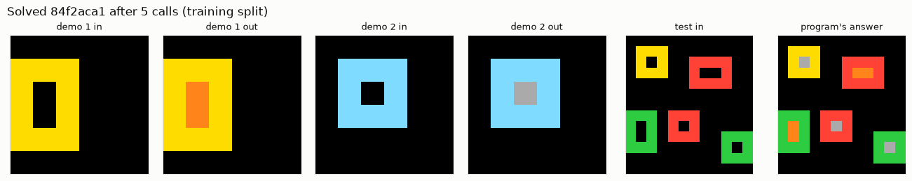
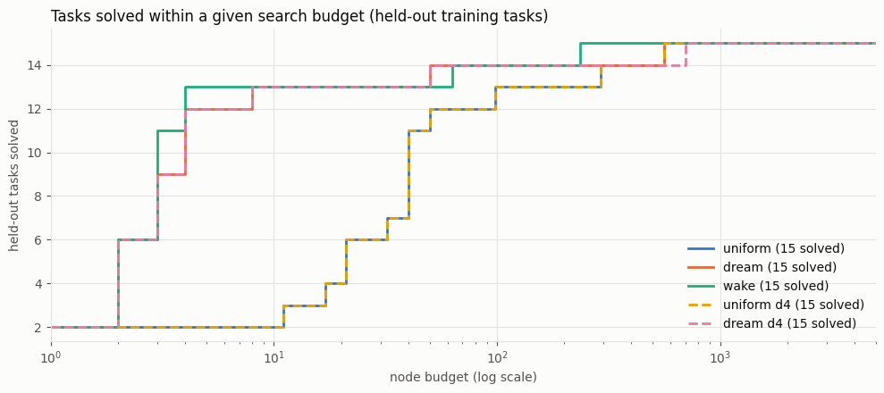
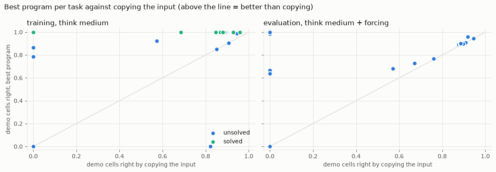

# ARC-AGI-2 solver: program search, a learned prior, and a test-time-trained LLM

A from-scratch attempt at [ARC-AGI-2](https://arcprize.org/arc-agi/2/), the abstraction-and-reasoning
benchmark where each task gives 2–5 example input/output grids and asks for the output of a new input.
Scoring is exact match with two attempts per test input.

The project compares three approaches that fail in different ways:

1. **A program-synthesis solver:** best-first search over a 55-primitive grid DSL, guided by a
   neural prior that predicts which primitives a task needs.
2. **An LLM solver:** Qwen3-0.6B and then Qwen3-1.7B, fine-tuned with LoRA on grids written as
   text (plus RE-ARC generated tasks for 1.7B), then trained again at test time on each task's own
   examples, with augmentation voting and likelihood re-ranking.
3. **LLM-written programs:** a local 20B reasoning model (`gpt-oss:20b`) writes a Python
   `transform(grid)`, which is kept only if it reproduces every example exactly, with feedback
   rounds for failed programs.

The combined solver uses the DSL's answer whenever one of its programs fits every example, then an
LLM-written program that fits every example, then the grid LLM's answer.


*A training task (`84f2aca1`) solved by a program that `gpt-oss:20b` wrote on its fifth call: fill
each shape's hole with grey if it is a single cell and with orange if it is larger. The program
reproduced both examples before it was trusted with the test input.*

## Results

| Solver | Training split (1000) | Evaluation split (120) |
|---|---|---|
| DSL search, uniform costs | **93.0** | 0 |
| DSL search + learned prior (184 held-out training tasks) | same 15/184, ~6x fewer nodes | 0 |
| LLM, zero-shot | – | 0 |
| LLM, LoRA fine-tuned | – | 0 |
| LLM, + per-task test-time training | – | **0.5** |
| LLM 1.7B + RE-ARC data, + per-task test-time training | – | 0 (closest: 1 of 175 cells wrong) |
| LLM 1.7B, + 4 sampled answers per view | – | 0 (correct grid among candidates for 1 of 167 tests) |
| LLM 1.7B, every candidate rescored, 5 rankers compared | – | 0 (perfect ranker: 1.5) |
| **LLM-written programs, gpt-oss:20b** (20-task pilots) | **10/20** (DSL: 2/20 on the same tasks) | 0/20 |
| **Combined (DSL, then LLM-written programs, then grid LLM)** | – | **0.5** |

The fine-tuned LLM was trained on the training split, so it is scored on the evaluation split only.
The evaluation split is ARC-AGI-2's public evaluation set; no model ever saw its test outputs.

These are small numbers: ARC-AGI-2 was designed to resist brute-force search, and every model here
runs on one 24 GB GPU. The project's value is in *why* each piece stalls:

- **The DSL is limited by what it can express, not by search.** The learned prior finds solutions
  after a median of 3 nodes instead of 34, yet solves exactly the same tasks; depth-4 programs add
  nothing. Adding primitives moved the training score from 74.5 to 93. On the evaluation split no
  program fits even the examples, because the grids are 3x larger and dominated by local,
  object-conditional edits. Details: [findings.md](findings.md), [analysis.ipynb](analysis.ipynb).
- **Fine-tuning taught the LLM the format, not the rules.** Valid grids rose from 57% to 77% and
  right-size answers from 32% to 61%. But on same-size tasks, cell accuracy (82%) was barely above
  just copying the input (80.3%).
- **Per-task test-time training is the first step that learns rules.** A separate adapter per task,
  trained only on that task's examples, reaches 84% cell accuracy and produced the first exact
  answer. Re-ranking candidates by the model's likelihood across views finds closer answers
  (90%+-correct answers rose from 36 to 48) but not more exact ones.
- **A larger model and more data push answers closer, not over the line.** Qwen3-1.7B trained with
  10,000 RE-ARC pseudo-tasks and per-task adapters is the best run on every near-miss measure: 89%
  valid grids, 85% cell accuracy, and 62 answers at least 90% correct. Three answers are within 1–2
  cells, but none is exact; the half-solve from 0.6B did not survive a different random draw.
- **Sampling found an answer that ranking threw away.** With 4 sampled answers per view, the exactly
  correct grid appears among the candidates for one test input (`2d0172a1`), but likelihood ranks it
  below wrong-size answers.
- **The ranker was not the main problem.** Testing the obvious explanation, that summed likelihood
  favours small grids, every candidate was rescored and five rankers compared offline. None helps:
  normalised per token, the correct grids still rank 4th and 14th, below answers 2–8 cells away. A
  perfect ranker would reach only 1.5/120, so generating the right answer at all (2 of 167 test
  inputs) is the bigger bottleneck.
- **Programs checked against the examples are the strongest approach, up to the model's reasoning
  limit.** Running the code on the examples is the outside check the grid model lacked: on 20
  training tasks, 11 programs passed and 10 of those were right on the test, against 2 solves for
  the DSL on the same tasks. On 20 evaluation tasks no program reproduces even one example of 19
  of them; the best programs beat copying the input by only a few points. With low reasoning the
  model gives up ("maybe identity?"); with medium reasoning it runs past the token budget, fixed by
  budget forcing (handing back its reasoning and demanding code). Details:
  [llm_findings.md](llm_findings.md), [llm_analysis.ipynb](llm_analysis.ipynb).

## In pictures


*Held-out training tasks solved within a given search budget. With the learned prior (dream, wake)
the DSL reaches its tasks after a handful of nodes instead of dozens, but every variant ends at the
same 15 tasks: search speed is not what limits it.*


*Best LLM-written program per task, measured on the examples, against simply copying the input. On
training tasks (left) half the tasks are solved (green, at 1.0); on evaluation tasks (right) the programs
sit just above the copy line: they get the easy cells right and miss the rule.*

More figures are in [analysis.ipynb](analysis.ipynb) (DSL) and [llm_analysis.ipynb](llm_analysis.ipynb) (LLMs).

## Layout

```
solver/            program-synthesis solver
  grid.py          task loading, background colour, connected objects (memoised)
  dsl.py           55 primitives: geometry, crops, symmetry, gravity, rays, logic ops, drawing...
  search.py        best-first search; colour-map and object-recolour fitting on top of programs
  features.py      task features for the prior (41 per pair, aggregated)
  prior.py         MLP prior trained on random "dream" programs (+ optional solved "wake" tasks)
run_eval.py        run the DSL solver over a split (multiprocess)
experiments.sh     every DSL experiment, resumable
llm/               LLM solver
  format.py        grids as text (one token per cell), invertible augmentations
  data.py          leave-one-out training data (+ --ttt: from evaluation examples only)
  train.py         LoRA fine-tuning, loss on answer tokens only
  ttt.py           per-task test-time training: one adapter per task
  infer.py         vLLM inference, augmentation voting, optional likelihood rescoring (--pool saves all candidates)
  rank.py          offline comparison of rankers on a saved candidate pool
  program.py       LLM-written programs via Ollama, checked against the examples, with revision and budget forcing
run_vllm.sh        environment wrapper for vLLM
combine.py         DSL + LLM-written programs + LLM -> Kaggle-format submission.json
analyze.py, build_notebook.py, build_llm_notebook.py, taskstats.py   analysis and notebooks
results/           every run's JSON and logs
docs/              figures used in this README (exported from the notebooks)
```

## Reproducing

Data: clone [arcprize/ARC-AGI-2](https://github.com/arcprize/ARC-AGI-2) into `data/arc-agi-2`.

```bash
# DSL solver (CPU)
bash experiments.sh                       # all DSL runs; WORKERS=100 on a big machine
python analyze.py                         # summary tables

# LLM solver (GPU; ran on one RTX A5000 24GB)
python -m llm.data --augs 2 --synthetic 5000                       # 13.6k training rows
python -m llm.train --data data/llm_train.jsonl --out models/lora_q06          # ~90 min
python -m llm.ttt --init-adapter models/lora_q06 --out models/ttt_tasks       # ~75 min, 120 adapters
bash run_vllm.sh --adapter models/lora_q06 --adapter-dir models/ttt_tasks --tag ttt_task_q06

# 1.7B with RE-ARC (github.com/michaelhodel/re-arc, its pre-generated re_arc.zip)
python -m llm.data --augs 2 --synthetic 2000 --re-arc re_arc/tasks --re-arc-per-task 25 --out data/llm_train_v2.jsonl
python -m llm.train --model Qwen/Qwen3-1.7B --data data/llm_train_v2.jsonl --out models/lora_q17   # ~4 h
python -m llm.ttt --model Qwen/Qwen3-1.7B --init-adapter models/lora_q17 --out models/ttt_tasks_q17  # ~2 h
bash run_vllm.sh --model Qwen/Qwen3-1.7B --adapter models/lora_q17 --adapter-dir models/ttt_tasks_q17 --rescore 8 --tag ttt_task_q17
bash run_vllm.sh --model Qwen/Qwen3-1.7B --adapter models/lora_q17 --adapter-dir models/ttt_tasks_q17 --samples 4 --rescore 12 --tag ttt_task_sample_q17
bash run_vllm.sh --model Qwen/Qwen3-1.7B --adapter models/lora_q17 --adapter-dir models/ttt_tasks_q17 --samples 4 --rescore 40 --pool --tag ttt_task_pool_q17  # ~3 h
python -m llm.rank results/llm_pool_evaluation_ttt_task_pool_q17.json

# LLM-written programs (needs an Ollama server with gpt-oss:20b on localhost:11434; ~15 min per task)
python -m llm.program --split training --sample 20 --attempts 2 --rounds 3 --think medium --tag pilot_gptoss
python -m llm.program --split evaluation --sample 20 --attempts 2 --rounds 3 --think medium --tag pilot_gptoss_force

# Combine and write a submission
python combine.py --dsl results/evaluation_v2_uniform.json \
                  --llm results/llm_evaluation_ttt_task_q06.json \
                  --prog results/prog_evaluation_pilot_gptoss_force.jsonl --out results/submission_evaluation.json
```

Environments: the DSL needs numpy, scikit-learn and joblib. Training needs torch, transformers and
peft. Inference needs vLLM, kept in a separate environment because its torch build differs.

## Where it would go next

- **LLM-written programs:** the check against the examples works; the generator is the limit. A
  stronger reasoning model, or many more samples per task with parallel requests, and a full
  training-split run with budget forcing for a firmer number than a 20-task pilot.
- **The grid LLM:** generating the right answer more often comes first: larger models (4–8B) and
  far more generated data, which is the scale published LLM approaches use. Ranking needs a signal
  from outside the model's likelihood, since size normalisation and shape filters did not help.
- **The DSL side:** object-wise combinators ("apply f to each object") and primitives parameterised
  by the examples, which is where the rules of the evaluation tasks live.
- **Verification:** reject coincidental DSL fits (14 training tasks fit every example but fail the
  test), and have the DSL check LLM answers against the examples.
